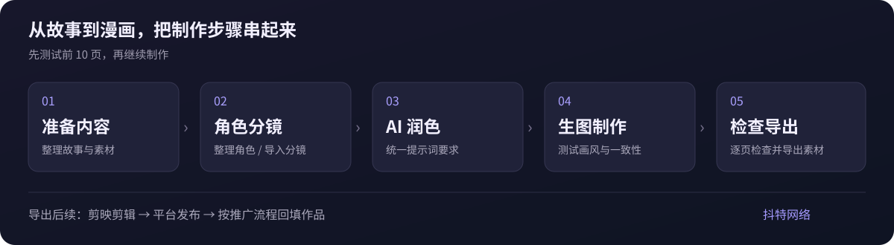

# AI漫画工作台

### 把小说内容，一步步做成连贯的 AI 漫画

面向小说推文与漫画创作者的 Windows 桌面工具

角色推理 · 分镜导入 · AI 润色 · 提示词前后缀 · 生图 · 检查导出

&nbsp;

Windows 10 / 11（64 位） · 安装后使用 · 需要联网

[下载与安装](#-下载与安装) · [主要功能](#-主要功能) · [快速开始](#-快速开始) · [常见问题](#-常见问题)

---

## 🖥️ 这是一个什么工具？

AI漫画工作台把在线漫画制作工具放进独立的电脑窗口，适合用大屏幕整理故事、编辑分镜、检查画面和导出素材。安装后双击桌面图标即可进入，不需要手动输入网页地址。

从小说内容出发，依次完成角色、分镜、提示词和画面的制作，再将导出的素材用于后续剪辑与发布。

> 软件通过网络使用在线服务。账号权限、模型可用性、API 额度及费用，以实际账号与接口服务为准。

## 📚 知乎小说推广授权 / 提取素材

**在微信小程序中搜索「抖特网络」，注册时填写邀请码 `66688`。**

1. 打开微信，进入小程序搜索。
2. 搜索并打开 **抖特网络**。
3. 注册时填写 **邀请码：`66688`**。
4. 在小程序中办理知乎小说推广授权、提取素材等事项，再按教程制作漫画。

办理流程或素材提取遇到问题，可联系客服微信 **`mechodd`**。

## ✨ 主要功能

| 功能 | 可以做什么 |
| --- | --- |
| 🧑 角色推理 | 根据故事整理角色，并为角色图片制作提供依据 |
| 🎞️ 分镜导入 | 将整理好的分镜内容导入制作流程 |
| ✍️ AI 润色 | 对分镜描述与绘图提示词进行润色 |
| 🧩 前后缀设置 | 统一添加画风、构图等提示词要求 |
| 🎨 生图制作 | 按实际配置的模型与接口生成漫画画面 |
| 🔎 检查与导出 | 逐页检查画面，完成需要的遮盖处理并导出素材 |
| 🖥️ 桌面使用 | 独立窗口、桌面快捷方式，支持刷新、缩放和全屏 |

具体功能和可用模型以在线工具当前提供的内容为准。

## 🧭 制作流程

先用前 10 页测试画风、角色一致性和分镜效果，确认后再继续制作。封面与开篇画面建议单独检查。

## 📥 下载与安装

| 系统 | 下载入口 | 安装文件 |
| --- | --- | --- |
| Windows 10 / 11（64 位） | **[下载 Windows 安装包](https://mh.xylos.cn/downloads/AI-Comic-Workbench-Setup.exe)** | `AI-Comic-Workbench-Setup.exe` |

主下载入口使用独立服务器，无需登录网盘。也可以使用 **[GitHub 备用下载](https://github.com/qcdwl/manhua/releases/latest/download/AI-Comic-Workbench-Setup.exe)**，或前往 [Releases 发布页](https://github.com/qcdwl/manhua/releases) 查看版本和附件。

1. 下载上面的 Windows 安装包。
2. 如果已安装旧版，请先完全退出正在运行的软件。
3. 双击安装包，按安装向导完成安装。
4. 从桌面或开始菜单打开 **AI漫画工作台**。
5. 注册或登录账号，按教程完成 API 配置后开始制作。

请下载上面的 `.exe` 安装包；使用 GitHub 备用下载时，请选择 Releases 中的 `.exe` 附件。GitHub 自动提供的 `Source code` 压缩包是仓库文件，不是软件安装包。

## 🚀 快速开始

1. **登录工作台**：打开软件，完成注册或登录。
2. **配置 API**：按教程配置推理、分镜润色和生图所需的接口与模型。
3. **准备故事与角色**：准备可使用的小说内容，整理角色并制作角色图。
4. **导入分镜**：导入分镜内容，检查顺序、文字和场景描述。
5. **润色与生图**：设置提示词前后缀，先做小批量测试，再继续生成。
6. **检查并导出**：检查封面、人物一致性及每页内容，导出需要的素材。

导出后，可以使用剪映继续制作视频，再按相应平台的要求发布、回填作品。剪辑和平台发布是工作台之外的后续步骤。

📖 **[查看完整图文教程](https://ncng8szhbogw.feishu.cn/wiki/Ck26wD5qvixxprkJyaqc85wDnwc?from=from_copylink)**  
📝 [查看快速上手说明](docs/quick-start.md)

## ❓ 常见问题

### 可以断网使用吗？

制作漫画需要连接在线服务与所配置的 AI 接口。安装包不包含本地大模型。

### 需要什么配置？

使用 Windows 10 / 11 的 64 位电脑，并保持网络连接。AI 请求通过所配置的接口处理，无需为了安装这个客户端而先下载模型。

### 是否需要账号和 API？

需要注册或登录工作台，并根据教程配置相应接口。可用模型、使用权限、额度和收费规则，以你的账号与接口服务为准。

### 知乎小说推广授权和素材提取在哪里操作？

在微信小程序中搜索 **抖特网络**，注册时填写 **邀请码 `66688`**。推广授权及素材提取的具体办理事项，请按小程序内流程操作；需要帮助时联系客服微信 **`mechodd`**。

### 下载慢、链接打不开怎么办？

优先使用 [主下载入口](https://mh.xylos.cn/downloads/AI-Comic-Workbench-Setup.exe)。如无法下载，可切换到 [GitHub 备用下载](https://github.com/qcdwl/manhua/releases/latest/download/AI-Comic-Workbench-Setup.exe)。仍有问题时，可联系客服微信 `mechodd` 获取帮助。

### 页面空白、连接失败或生成失败怎么办？

先检查网络并刷新页面，再检查登录状态、接口配置、模型可用性与额度。如果仍有问题，反馈时请提供软件版本、操作步骤和错误提示；截图中请遮住密码和 API 密钥。

### 如何更新？

从本仓库下载新版安装包，退出旧版后重新安装。本客户端当前通过下载安装包更新。

## 📌 使用说明

- 本仓库用于发布 Windows 客户端、使用说明与更新记录，不包含服务端源码或模型。
- 请在拥有相应使用权或已获授权的范围内处理小说、图片及其他素材。
- 小说授权或素材提取的具体事项，请联系客服确认；本软件不代表相关内容平台作出授权承诺。

## 👤 联系与反馈

| 项目 | 信息 |
| --- | --- |
| 微信小程序 | **抖特网络** |
| 知乎小说推广授权 / 提取素材 | 微信小程序内办理 |
| 小程序注册邀请码 | **`66688`** |
| 客服微信 | **`mechodd`** |
| 问题反馈 | [提交 Issue](https://github.com/qcdwl/manhua/issues) |
| 版本记录 | [查看更新日志](CHANGELOG.md) |

## ⭐ 支持项目

如果这个工具对你有帮助，欢迎点一个 Star，也欢迎把这个项目分享给需要制作 AI 漫画的朋友。
